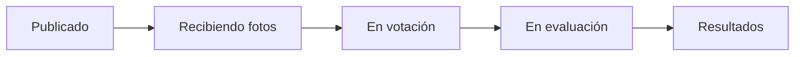

<h1 align="center">🏆 Foncholuis Art Challenge Manager</h1>

<p align="center">
  <strong>Retos fotográficos y concursos de arte para tu sitio WordPress.</strong><br>
  Inscripción de participantes, envío de fotos, votación con email confirmado y resultados con empates.
</p>

<p align="center">
  
  
  
  
</p>

<p align="center">
  
</p>

Pensado para asociaciones de fotografía, escuelas y organizaciones que ya tienen su web en WordPress y quieren organizar retos de fotografía, dibujo, diseño o cualquier otra disciplina, sin servicios externos.

## Qué incluye

| | |
|---|---|
| 🗓️ **Calendario por reto** | Inicio, fin de los envíos, fin de la votación y publicación de resultados. La fase de cada reto se calcula sola. |
| 🔓 **Retos abiertos o cerrados** | Las fotos se ven al enviarse o solo cuando terminan los envíos. |
| 🔒 **Retos privados** | Limita participantes y, si quieres, votantes a una lista de emails. |
| 🙋 **Inscripción y aprobación** | Formulario público con foto y redes sociales. Filtra, aprueba o desactiva en bloque desde el panel. |
| 🔗 **Enlace personal** | Cada participante aprobado recibe por email un enlace para subir sus fotos, sin contraseñas. |
| 🗳️ **Votación con email confirmado** | De 1 a 3 votos por reto. Con varios, cada votante elige su 1.º, 2.º y 3.º, que valen 3, 2 y 1 puntos, y puede cambiarlos mientras dure la votación. |
| 🕶️ **Votación anónima** | Opción por reto para ocultar el título y el autor de las fotos hasta que termina la votación. |
| 🥇 **Resultados con empates** | Uno o tres lugares, premios opcionales y empates con la misma prominencia. |
| 🏅 **Clasificación anual** | Suma los votos de cada persona en los retos terminados del año, en la portada y en cada reto. |
| 👤 **Perfiles de participante** | Foto, redes, retos, fotos y puestos, sin mostrar nunca el email. Se pueden desactivar en **Retos → Ajustes**. |
| 📣 **Avisos de nuevos retos** | Quien se suscribe recibe un email al publicarse un reto, y puede darse de baja cuando quiera. |
| 🧬 **Duplicar retos** | Crea una nueva edición en un clic, copiando o no a sus participantes activos. |
| 🎨 **Diseño por reto** | Los colores del tema o 10 paletas armónicas, y 3 tamaños de texto. La tipografía siempre es la de tu tema. |
| 🖼️ **Fondo de iconos** | Un mosaico de 44 iconos de fotografía con el color del reto, que se funde con el fondo de la página. Se activa por reto en la portada, el detalle y la inscripción. |
| 🌍 **Inglés y español** | Traducción completa al español en `languages/`, para aportarla a translate.wordpress.org, que es quien la distribuye (el ZIP del plugin no incluye traducciones). Las direcciones siguen el idioma del sitio: `/retos/` o `/challenges/`. |
| 🔌 **REST API** | La configuración de cada reto se lee y se cambia en el campo `concursos` de `/wp-json/wp/v2/concurso_reto`, con un usuario que pueda editarlo (por ejemplo, con una contraseña de aplicación). |
| 🧹 **Desinstalación limpia** | Al borrar el plugin desde WordPress se eliminan sus retos, participantes, fotos, votos y ajustes. |

## Capturas

<table>
  <tr>
    <td width="50%"><p align="center"><sub>Un reto en votación</sub></p></td>
    <td width="50%"><p align="center"><sub>Resultados con premios y empates</sub></p></td>
  </tr>
  <tr>
    <td><p align="center"><sub>Panel de retos</sub></p></td>
    <td><p align="center"><sub>Votantes y en qué retos votaron</sub></p></td>
  </tr>
  <tr>
    <td><p align="center"><sub>Participación, premios y diseño</sub></p></td>
    <td><p align="center"><sub>Perfil de participante</sub></p></td>
  </tr>
</table>

### Paletas

Diez combinaciones tomadas de las más populares de [Coolors](https://coolors.co/palettes/popular/modern), todas con contraste AA.

<p align="center"></p>

### Fondo de iconos

Cada reto decide en qué páginas aparece: portada de retos, detalle del reto o inscripción. Si se desmarcan todas, no se muestra. La portada y la inscripción siguen al reto destacado.

<p align="center"></p>

## Instalación

**Requisitos:** WordPress 7.1 o posterior y PHP 7.4 o posterior.

1. Descarga el ZIP con **Code → Download ZIP**. Solo contiene el plugin.
2. En tu WordPress, ve a **Plugins → Añadir nuevo → Subir plugin**, elige el ZIP y actívalo.
3. Crea tu primer reto en **Retos → Crear nuevo reto**.
4. Añade al menú las páginas **Retos** e **Inscripción a retos**, que el plugin crea al activarse: en **Apariencia → Editor → Navegación** con temas de bloques, o en **Apariencia → Menús** con temas clásicos.

## Las páginas del plugin

Al activarse, el plugin crea dos páginas normales de WordPress. En **Páginas** aparecen marcadas como «Página de retos» y «Página de inscripción». Puedes cambiarles el título, añadirlas al menú o moverlas como cualquier otra página.

| Página | Qué muestra | Cómo funciona |
|---|---|---|
| **Retos** (`/retos/`, o `/challenges/` si el sitio está en inglés) | El reto en curso destacado, los próximos, los anteriores y la clasificación anual. | El plugin pinta su contenido, así que lo que escribas en ella no se muestra. Cada reto tiene además su propia página, `/retos/nombre-del-reto/`, con sus fotos, la votación y los resultados. |
| **Inscripción a retos** | El formulario para inscribirse en un reto: nombre, email, foto y redes. | Lleva el shortcode `[concursos_inscripcion]`, que es el que muestra el formulario. Puedes añadir texto antes o después, o poner el shortcode en otra página. |

- Los botones **Inscribirme en un reto** (en la página Retos) e **Inscribirme en este reto** (en cada reto) llevan a la primera página publicada que contiene el shortcode. Solo aparecen si esa página existe y hay algún reto **próximo** o **recibiendo fotos**.
- El formulario para **registrarse como votante** no necesita ninguna página: aparece en la propia página del reto durante la fase de votación.
- Si borras una de estas páginas, el plugin no la vuelve a crear. Para recuperar la inscripción, crea una página con el bloque **Shortcode** y escribe `[concursos_inscripcion]`. Sin la página Retos, la lista sigue disponible en `/retos/`.
- Si ya tenías una página con el shortcode antes de activar el plugin, se usa esa y no se crea otra.

## REST API

Los retos están en la REST API de WordPress, en `/wp-json/wp/v2/concurso_reto`, con su título, contenido, estado e imagen. La configuración de cada reto va en el campo `concursos`:

| Campo | Valores |
|---|---|
| `inicio`, `fin_envios`, `fin_votacion`, `cierre` | Fechas en la zona horaria del sitio, con el formato `AAAA-MM-DDTHH:MM` |
| `modo` | `abierto` o `cerrado` |
| `votos_por_votante` | De 1 a 3 |
| `lugares` | 1 o 3 |
| `max_fotos` | De 1 a 20 |
| `anonimo`, `privado_participantes`, `privado_votantes` | `true` o `false` |
| `emails_participantes`, `emails_votantes` | Emails separados por comas |
| `premios` | Hasta 3 textos, del 1.º al 3.º |
| `reglas` | Texto |
| `paleta` | `tema` o una paleta: `playa`, `brisa`, `otono`, `oro`, `intensos`, `baya`, `naturaleza`, `azul`, `tierra`, `naranja` |
| `tamano` | `pequeno`, `normal` o `grande` |
| `fondo_iconos` | Páginas con fondo: `portada`, `detalle`, `inscripcion` |
| `fase` | Solo lectura: la fase actual del reto |

- El campo solo se muestra y se acepta para usuarios que pueden editar el reto, con `context=edit`, porque incluye las listas de emails de los retos privados.
- Al cambiar un reto, los valores que no se envían se conservan. Si las fechas no tienen sentido, el cambio se rechaza con el mismo mensaje que en el panel.
- Para listar también borradores y archivados, añade `status=any`.
- Publicar un reto envía el aviso por email a los suscritos. Si lo creas por la API, créalo como borrador y publícalo cuando esté listo.

### Crear una contraseña de aplicación

La API necesita un usuario con permiso para editar retos, normalmente un administrador. En lugar de su contraseña normal se usa una contraseña de aplicación, que se puede revocar en cualquier momento:

1. Entra en el administrador de WordPress con ese usuario y ve a **Usuarios → Perfil**.
2. Baja hasta **Contraseñas de aplicación**. El sitio tiene que usar HTTPS para que aparezca.
3. Escribe un nombre que la identifique, por ejemplo «API retos», y pulsa **Añadir nueva contraseña de aplicación**.
4. Copia la contraseña que aparece: solo se muestra una vez. Los espacios son opcionales.
5. Úsala con el nombre de usuario en autenticación básica:

```bash
curl -u "usuario:xxxx xxxx xxxx xxxx xxxx xxxx" \
  "https://tu-sitio/wp-json/wp/v2/concurso_reto?context=edit&status=any"

curl -u "usuario:xxxx xxxx xxxx xxxx xxxx xxxx" -X POST \
  -H "Content-Type: application/json" \
  -d '{"title":"Nuevo reto","status":"draft","concursos":{"inicio":"2027-03-01T10:00","fin_envios":"2027-03-10T23:59","fin_votacion":"2027-03-15T23:59","cierre":"2027-03-16T10:00","votos_por_votante":3}}' \
  "https://tu-sitio/wp-json/wp/v2/concurso_reto"
```

Para revocarla, vuelve a **Usuarios → Perfil → Contraseñas de aplicación** y pulsa **Revocar** junto a su nombre.

## Cómo funciona un reto



Un reto solo se ve en el sitio cuando está **publicado**. Los borradores y los retos **archivados** permanecen ocultos y no envían avisos.

## Desarrollo local

Necesitas Docker y `make`.

```bash
cp .env.example .env        # opcional: puertos y credenciales
make install                # levanta todo, instala WordPress en español y activa el plugin
make demo                   # reto de ejemplo con participantes y fotos
make demo FASE=votacion     # el mismo reto en votación (o FASE=finalizado, con resultados)
make e2e                    # pruebas de extremo a extremo (T=votacion para una sola)
make i18n                   # regenera .pot, .po y .mo (NUEVAS=pares.json añade traducciones)
make wp c="plugin list"     # cualquier comando de wp-cli
make debug-log              # sigue wp-content/debug.log
make down                   # detiene (conserva los datos)
make reset                  # borra todo
```

| Servicio    | URL                            | Acceso        |
|-------------|--------------------------------|---------------|
| WordPress   | http://localhost:8080          |               |
| Admin       | http://localhost:8080/wp-admin | admin / admin |
| phpMyAdmin  | http://localhost:8081          | automático    |
| Mailpit     | http://localhost:8025          | emails de prueba |

La raíz del repositorio es el plugin y está montada en `wp-content/plugins/foncholuis-art-challenge-manager`: los cambios se ven al recargar el navegador. En local, ningún email sale de verdad; todos llegan a Mailpit.

## Licencia

[GPL-2.0 o posterior](LICENSE). Las fotos de las capturas y de la demo son de muestra, servidas por [Lorem Picsum](https://picsum.photos) bajo la [licencia de Unsplash](https://unsplash.com/license). Los iconos del fondo son [Material Symbols](https://fonts.google.com/icons) de Google, bajo la [licencia Apache 2.0](https://www.apache.org/licenses/LICENSE-2.0).
