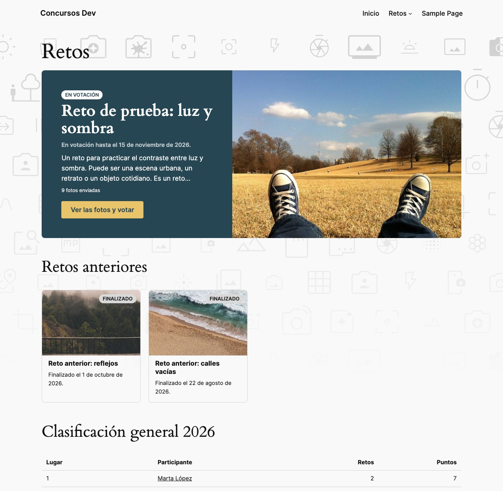
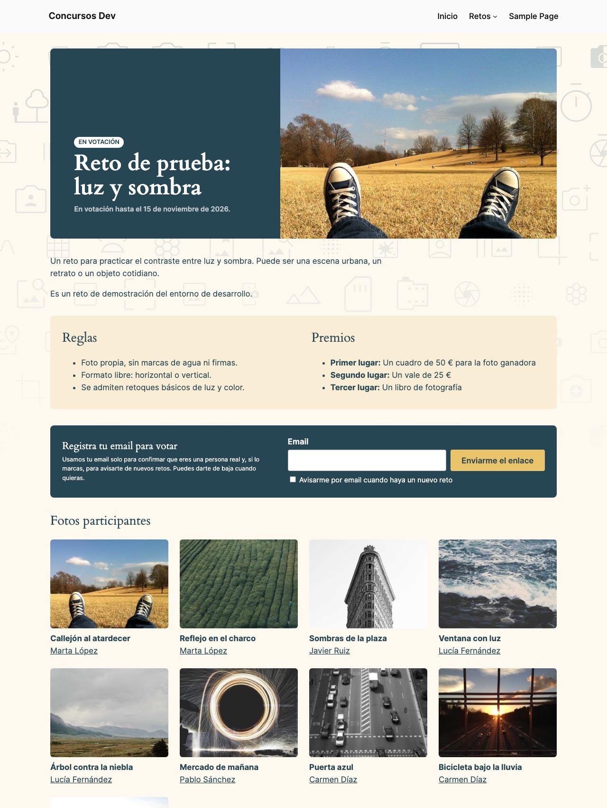
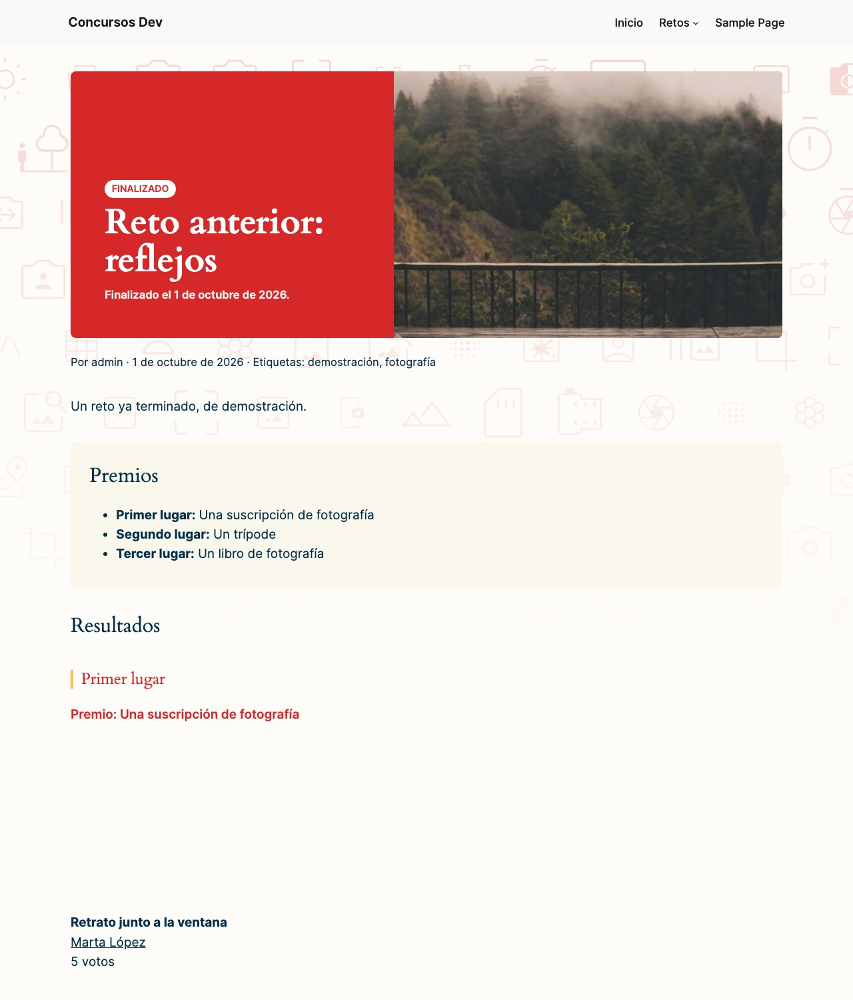
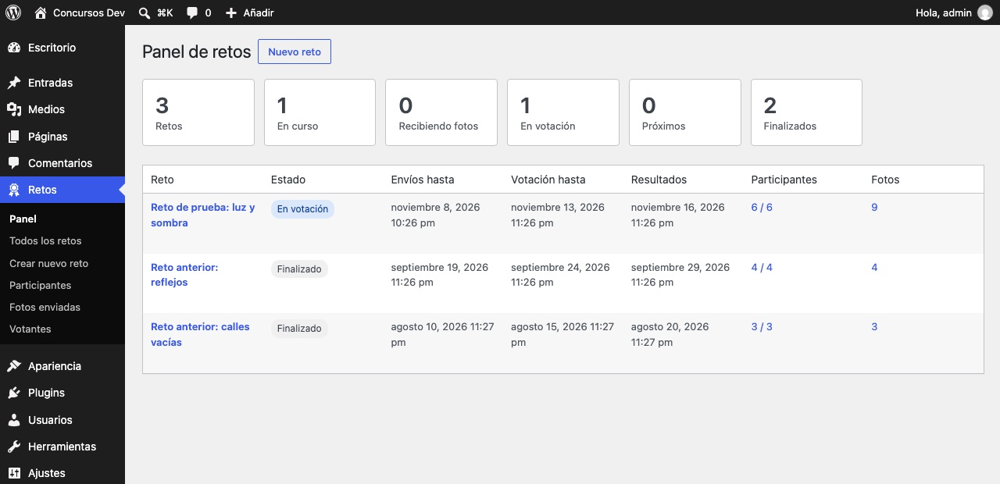
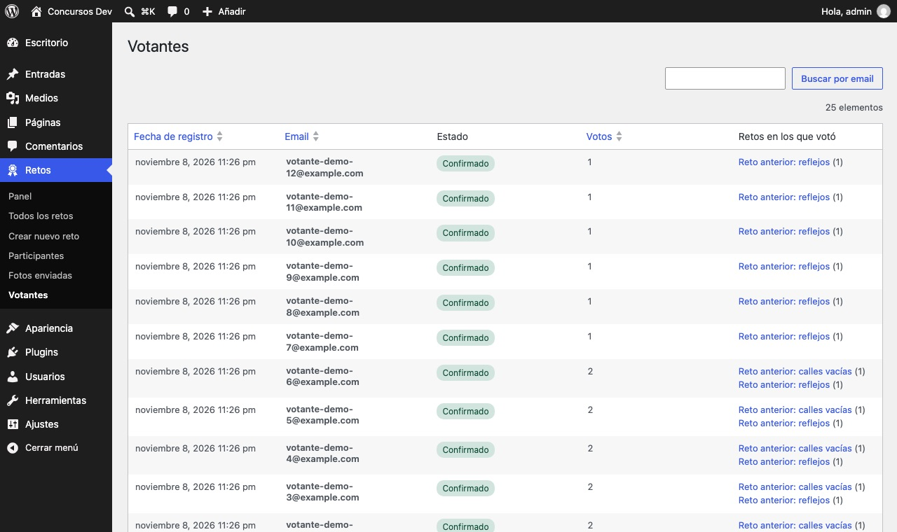
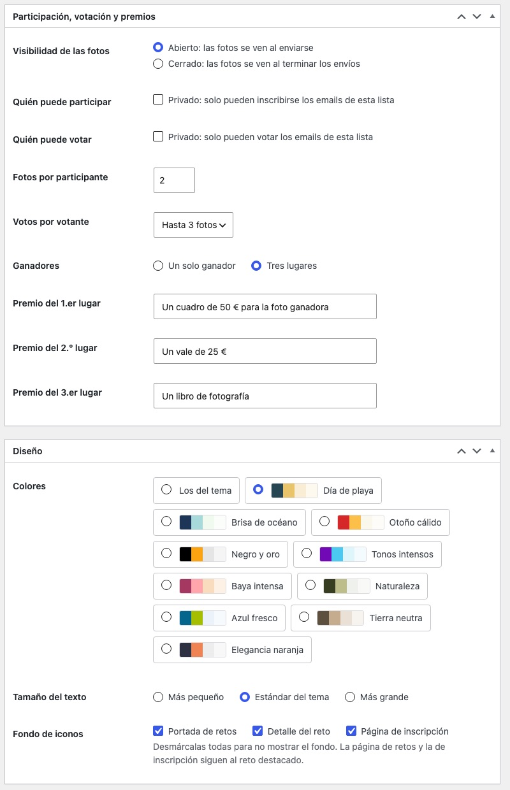
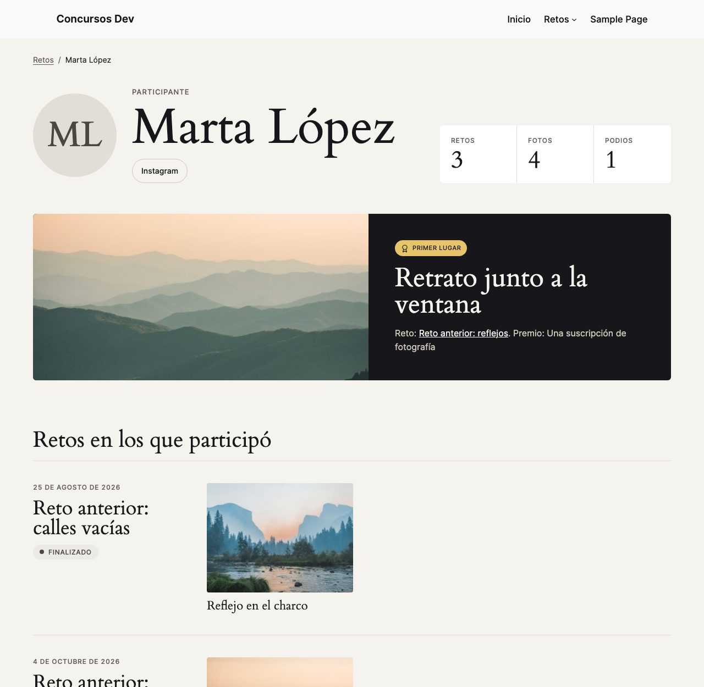
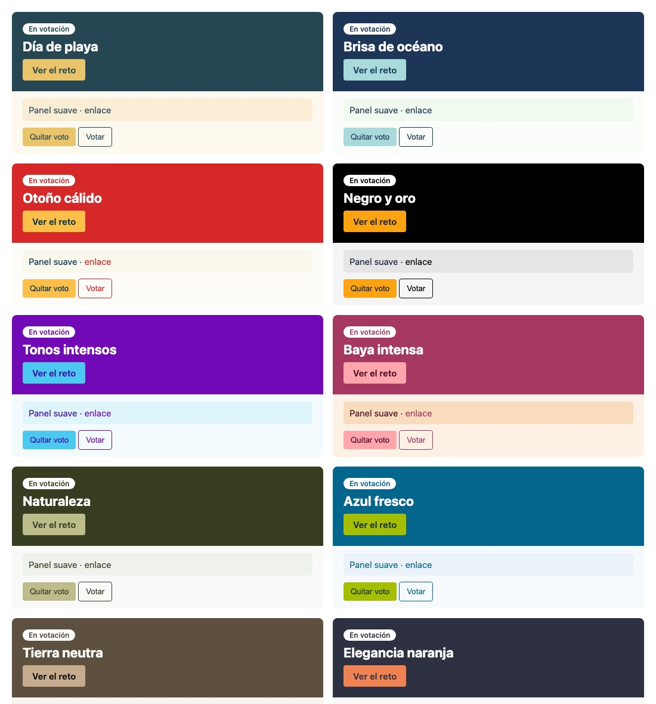
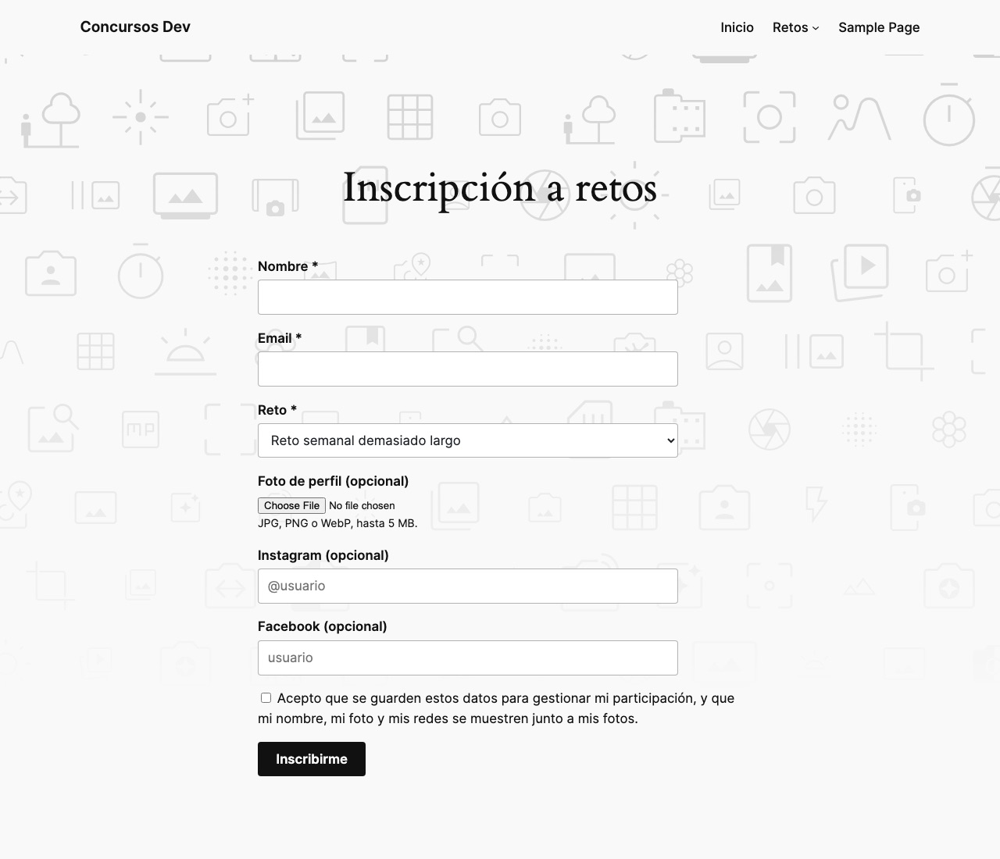
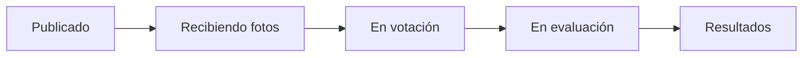

<h1 align="center">🏆 Photo Challenges</h1>

<p align="center">
  <strong>Retos fotográficos y concursos de arte para tu sitio WordPress.</strong><br>
  Inscripción de participantes, envío de fotos, votación con email confirmado y resultados con empates.
</p>

<p align="center">
  
  
  
  
</p>

<p align="center">
  
</p>

Pensado para asociaciones de fotografía, escuelas y organizaciones que ya tienen su web en WordPress y quieren organizar retos de fotografía, dibujo, diseño o cualquier otra disciplina, sin servicios externos.

## Qué incluye

| | |
|---|---|
| 🗓️ **Calendario por reto** | Inicio, fin de los envíos, fin de la votación y publicación de resultados. La fase de cada reto se calcula sola. |
| 🔓 **Retos abiertos o cerrados** | Las fotos se ven al enviarse o solo cuando terminan los envíos. |
| 🔒 **Retos privados** | Limita participantes y, si quieres, votantes a una lista de emails. |
| 🙋 **Inscripción y aprobación** | Formulario público con foto y redes sociales. Filtra, aprueba o desactiva en bloque desde el panel. |
| 🔗 **Enlace personal** | Cada participante aprobado recibe por email un enlace para subir sus fotos, sin contraseñas. |
| 🗳️ **Votación con email confirmado** | De 1 a 3 votos por reto, con posibilidad de retirar un voto mientras dure la votación. |
| 🥇 **Resultados con empates** | Uno o tres lugares, premios opcionales y empates con la misma prominencia. |
| 🏅 **Clasificación anual** | Suma los votos de cada persona en los retos terminados del año, en la portada y en cada reto. |
| 👤 **Perfiles de participante** | Foto, redes, retos, fotos y puestos, sin mostrar nunca el email. |
| 📣 **Avisos de nuevos retos** | Quien se suscribe recibe un email al publicarse un reto, y puede darse de baja cuando quiera. |
| 🧬 **Duplicar retos** | Crea una nueva edición en un clic, copiando o no a sus participantes activos. |
| 🎨 **Diseño por reto** | Los colores del tema o 10 paletas armónicas, y 3 tamaños de texto. La tipografía siempre es la de tu tema. |
| 🖼️ **Fondo de iconos** | Un mosaico de 44 iconos de fotografía con el color del reto, que se funde con el fondo de la página. Se activa por reto en la portada, el detalle y la inscripción. |
| 🌍 **Inglés y español** | Traducción completa, válida para cualquier variante regional del español. Las direcciones siguen el idioma del sitio: `/retos/` o `/challenges/`. |
| 🧹 **Desinstalación limpia** | Al borrar el plugin desde WordPress se eliminan sus retos, participantes, fotos, votos y ajustes. |

## Capturas

<table>
  <tr>
    <td width="50%"><p align="center"><sub>Un reto en votación</sub></p></td>
    <td width="50%"><p align="center"><sub>Resultados con premios y empates</sub></p></td>
  </tr>
  <tr>
    <td><p align="center"><sub>Panel de retos</sub></p></td>
    <td><p align="center"><sub>Votantes y en qué retos votaron</sub></p></td>
  </tr>
  <tr>
    <td><p align="center"><sub>Participación, premios y diseño</sub></p></td>
    <td><p align="center"><sub>Perfil de participante</sub></p></td>
  </tr>
</table>

### Paletas

Diez combinaciones tomadas de las más populares de [Coolors](https://coolors.co/palettes/popular/modern), todas con contraste AA.

<p align="center"></p>

### Fondo de iconos

Cada reto decide en qué páginas aparece: portada de retos, detalle del reto o inscripción. Si se desmarcan todas, no se muestra. La portada y la inscripción siguen al reto destacado.

<p align="center"></p>

## Instalación

**Requisitos:** WordPress 7.1 o posterior y PHP 7.4 o posterior.

1. Descarga el ZIP con **Code → Download ZIP**. Solo contiene el plugin.
2. En tu WordPress, ve a **Plugins → Añadir nuevo → Subir plugin**, elige el ZIP y actívalo.
3. Crea tu primer reto en **Retos → Crear nuevo reto**.
4. Crea una página con el shortcode `[concursos_inscripcion]` para que la gente se inscriba.
5. Añade al menú la página **Retos**, que el plugin crea automáticamente: en **Apariencia → Editor → Navegación** con temas de bloques, o en **Apariencia → Menús** con temas clásicos.

## Cómo funciona un reto



Un reto solo se ve en el sitio cuando está **publicado**. Los borradores y los retos **archivados** permanecen ocultos y no envían avisos.

## Desarrollo local

Necesitas Docker y `make`.

```bash
cp .env.example .env        # opcional: puertos y credenciales
make install                # levanta todo, instala WordPress en español y activa el plugin
make demo                   # reto de ejemplo con participantes y fotos
make demo FASE=votacion     # el mismo reto en votación (o FASE=finalizado, con resultados)
make wp c="plugin list"     # cualquier comando de wp-cli
make debug-log              # sigue wp-content/debug.log
make down                   # detiene (conserva los datos)
make reset                  # borra todo
```

| Servicio    | URL                            | Acceso        |
|-------------|--------------------------------|---------------|
| WordPress   | http://localhost:8080          |               |
| Admin       | http://localhost:8080/wp-admin | admin / admin |
| phpMyAdmin  | http://localhost:8081          | automático    |
| Mailpit     | http://localhost:8025          | emails de prueba |

La raíz del repositorio es el plugin y está montada en `wp-content/plugins/photo-challenges`: los cambios se ven al recargar el navegador. En local, ningún email sale de verdad; todos llegan a Mailpit.

## Licencia

[GPL-2.0 o posterior](LICENSE). Las fotos de las capturas y de la demo son de muestra, servidas por [Lorem Picsum](https://picsum.photos) bajo la [licencia de Unsplash](https://unsplash.com/license). Los iconos del fondo son [Material Symbols](https://fonts.google.com/icons) de Google, bajo la [licencia Apache 2.0](https://www.apache.org/licenses/LICENSE-2.0).
